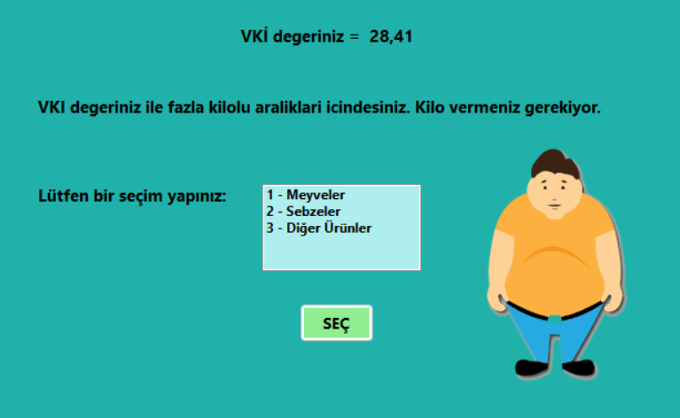
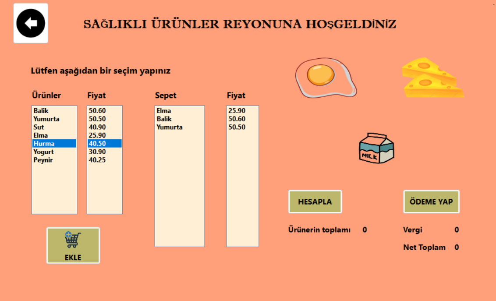
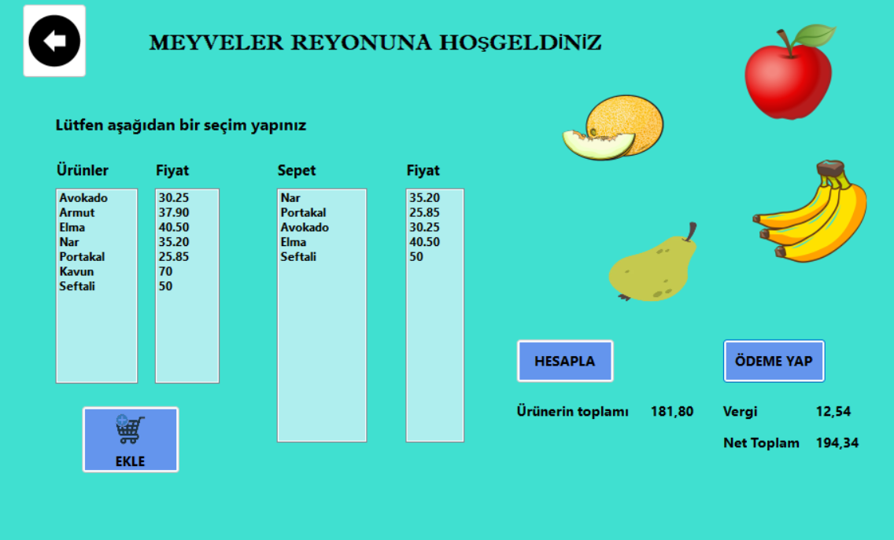

# 🛒 BMI-Based Smart Grocery Recommendation System

A **C# Windows Forms** desktop application that calculates a user's **Body Mass Index (BMI)** from height and weight inputs, evaluates their health category, recommends tailored grocery aisles, and handles cart, tax, and checkout workflows within each aisle.

---

## 🖥️ Application Screens & Workflow

### 1. Home & BMI Calculation Screen
The user enters their height in centimeters (cm) and weight in kilograms (kg) and clicks **CALCULATE (HESAPLA)**. The system computes the BMI value and navigates to the corresponding result screen.

  

---

### 2. BMI Analysis & Aisle Recommendation Screens
Based on the calculated BMI, the system classifies the user into **Underweight**, **Normal Weight**, or **Overweight**, provides health guidance, and presents goal-oriented grocery aisle options:

* **Underweight Range:** Directs the user to aisles tailored for healthy or general weight gain.

  

* **Normal Weight Range:** Offers aisle selections focused on weight maintenance, healthy weight gain, or muscle building.

  

* **Overweight Range:** Recommends weight loss and lists balanced, lower-calorie grocery aisles.

  

---

### 3. Grocery Aisles & Shopping Views
Selecting any of the **5 recommended aisles** opens its dedicated shopping window displaying category-specific products and prices. Users can add items to their cart, view the subtotal via **CALCULATE (HESAPLA)**, compute tax-inclusive net totals via **CHECKOUT (ÖDEME YAP)**, and return to the previous menu using the back button to shop across multiple aisles.

#### 🥗 Healthy Products Aisle

  

#### 🧀 General Food Products Aisle

  

#### 💪 High-Protein Products Aisle

  

#### 🍎 Fruits Aisle

  

#### 🥦 Vegetables Aisle

  

---

## ✨ Features

* **Automated BMI Calculation & Classification:** Computes BMI from height/weight inputs and delivers tailored feedback across Underweight, Normal, and Overweight ranges.
* **Personalized Aisle Routing:** Directs users to **5 distinct grocery aisles** (*Healthy Products, Food Products, High-Protein Products, Fruits, Vegetables*) aligned with their BMI goals.
* **Dynamic Cart & Subtotal Calculation:** Interactive product selection, live cart listing, and instant subtotal computation.
* **Tax & Checkout Processing:** Automated tax calculation on cart totals, net payable display, and payment confirmation dialog.
* **Multi-Aisle Navigation:** Back-navigation support allowing users to switch between recommended aisles seamlessly.

---

## 🛠️ Tech Stack

* **Language:** C#
* **UI Framework:** Windows Forms (WinForms)
* **IDE:** Visual Studio
