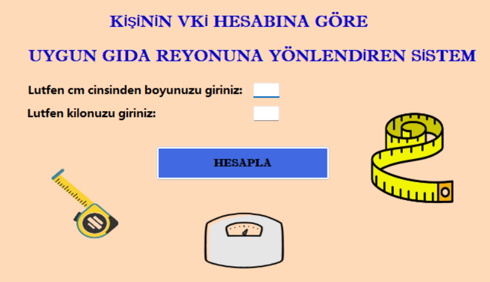
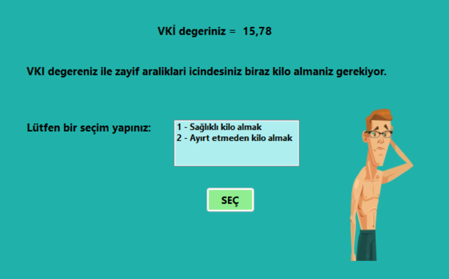
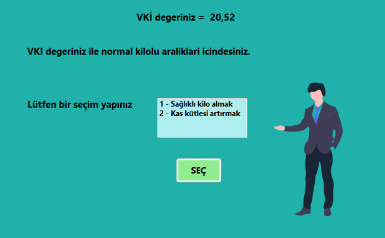
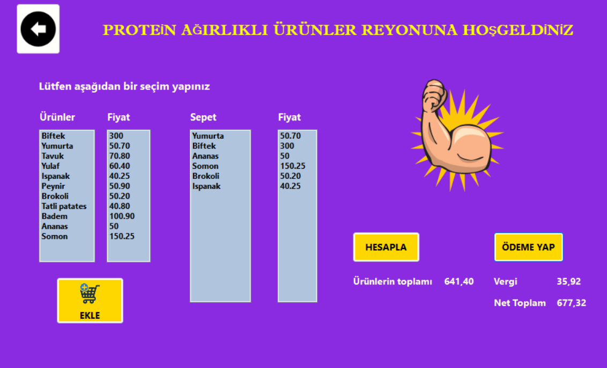
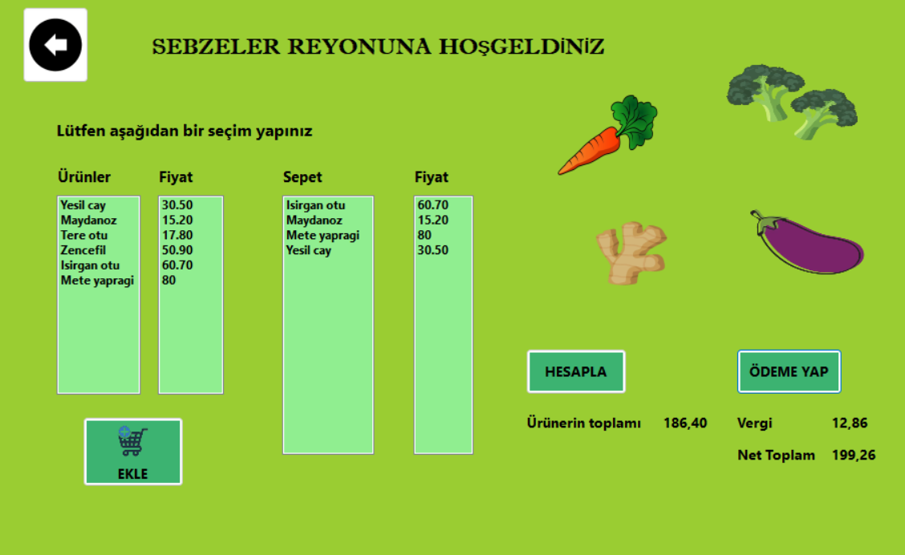

# 🛒 VKİ Tabanlı Akıllı Market Yönlendirme Sistemi

Kullanıcıların boy ve kilo bilgilerine göre **Vücut Kitle İndeksini (VKİ)** hesaplayan, çıkan sonuca göre sağlık durumunu analiz ederek kişiye özel market reyonları öneren ve seçilen reyonlarda sepet, vergi ve ödeme işlemlerini gerçekleştiren **C# Windows Forms** masaüstü uygulamasıdır.

---

## 🖥️ Uygulama Ekranları ve Akış

### 1. Giriş ve VKİ Hesaplama Ekranı
Kullanıcı santimetre (cm) cinsinden boyunu ve kilogram cinsinden kilosunu girerek **HESAPLA** butonuna tıklar. Sistem VKİ değerini otomatik olarak hesaplar ve ilgili sonuç ekranına yönlendirir.

  

---

### 2. VKİ Analizi ve Reyon Yönlendirme Ekranları
Hesaplanan VKİ değerine göre sistem kullanıcıyı **Zayıf**, **Normal Kilolu** veya **Fazla Kilolu** kategorilerinden birine yerleştirir, sağlık önerisinde bulunur ve hedefine uygun reyon seçeneklerini sunar:

* **Zayıf Aralığı:** Sağlıklı kilo almak veya ayırt etmeden kilo almak için uygun reyonlara yönlendirir.

  

* **Normal Kilolu Aralığı:** Formu korumak, sağlıklı kilo almak veya kas kütlesi artırmak için reyon seçenekleri sunar.

  

* **Fazla Kilolu Aralığı:** Kilo verme önerisiyle birlikte düşük kalorili ve dengeli reyon seçeneklerini listeler.

  

---

### 3. Market Reyonları ve Alışveriş Ekranları
Kullanıcı kendisine önerilen **5 farklı reyondan** birini seçtiğinde ilgili reyon penceresi açılır. Her reyonda o kategoriye özel ürünler ve birim fiyatları listelenir. Kullanıcı ürünleri sepetine ekleyebilir, **HESAPLA** butonu ile ara toplamı görebilir, **ÖDEME YAP** butonu ile vergi dahil net tutarı hesaplayıp ödemesini tamamlayabilir. Sol üstteki geri butonu ile bir önceki menüye dönülerek diğer reyonlardan da alışveriş yapılabilir.

#### 🥗 Sağlıklı Ürünler Reyonu

  

#### 🧀 Gıda Ürünleri Reyonu

  

#### 💪 Protein Ağırlıklı Ürünler Reyonu

  

#### 🍎 Meyveler Reyonu

  

#### 🥦 Sebzeler Reyonu

  

---

## ✨ Özellikler

* **Otomatik VKİ Hesaplama ve Sınıflandırma:** Boy ve kilo verileriyle VKİ hesaplama; Zayıf, Normal ve Fazla Kilolu aralıklarına göre dinamik geri bildirim.
* **Kişiselleştirilmiş Reyon Önerisi:** Kullanıcının VKİ aralığına ve hedefine uygun **5 farklı reyon** (*Sağlıklı Ürünler, Gıda Ürünleri, Protein Ağırlıklı Ürünler, Meyveler, Sebzeler*) arasında yönlendirme.
* **Dinamik Sepet ve Fiyat Hesaplama:** Reyon içerisinden ürün seçimi, anlık sepet listeleme ve toplam tutar hesaplama.
* **Vergi ve Ödeme Sistemi:** Sepet tutarı üzerinden otomatik vergi hesaplama, net toplam gösterimi ve ödeme onay bildirimi.
* **Çoklu Reyon Gezinmesi:** Geri dönme butonu sayesinde önceki menüye dönüp farklı reyonlardan alışverişe devam edebilme.

---

## 🛠️ Kullanılan Teknolojiler

* **Dil:** C#
* **Arayüz:** Windows Forms (WinForms)
* **Geliştirme Ortamı:** Visual Studio
