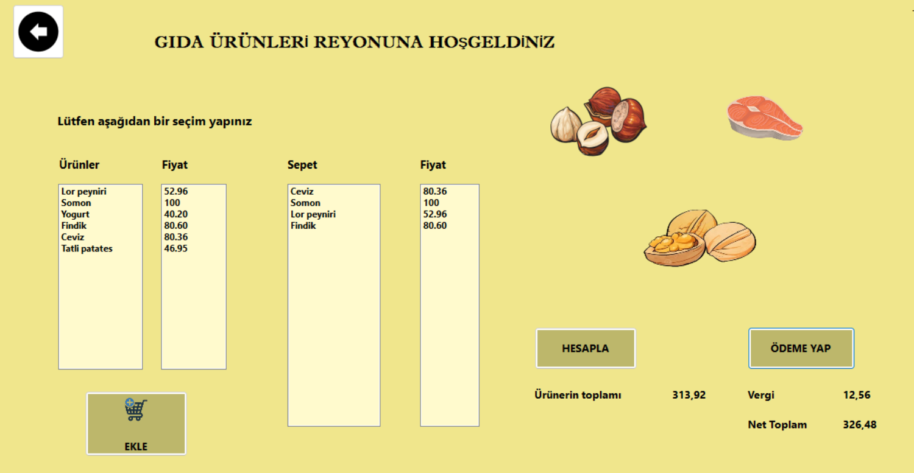

# 🛒 BMI-Based Smart Grocery Routing System

A **C# Windows Forms** desktop application that calculates a user's **Body Mass Index (BMI)** from height and weight inputs, evaluates their health category, recommends tailored grocery aisles, and handles cart, tax, and checkout workflows.

---

## 🖥️ Application Screens & Workflow

### 1. Home & BMI Calculation Screen
Users enter their height in centimeters (cm) and weight in kilograms (kg), then click **Calculate** (`HESAPLA`)[cite: 6]. The system computes the BMI value and navigates to the corresponding evaluation screen.

  

---

### 2. BMI Evaluation & Aisle Recommendation Screens
Based on the calculated BMI, the system classifies the user into **Underweight**, **Normal Weight**, or **Overweight**, provides health guidance, and lists recommended grocery aisles aligned with their goals:

* **Underweight Category:** Recommends aisles tailored for healthy or general weight gain[cite: 12].

  

* **Normal Weight Category:** Offers aisle selections focused on weight maintenance, healthy weight gain, or muscle mass building[cite: 8].

  

* **Overweight Category:** Provides weight-loss recommendations alongside low-calorie, balanced aisle options[cite: 4].

  

---

### 3. Grocery Aisles & Shopping Screens
Selecting any of the **5 specialized aisles** opens the corresponding store window displaying category-specific products and unit prices[cite: 5, 7, 9, 10, 11]. Users can add items to their cart, view the subtotal via **Calculate** (`HESAPLA`), and finalize the transaction with tax calculation via **Pay** (`ÖDEME YAP`)[cite: 5, 7, 9, 10, 11]. The back button in the top-left corner allows returning to the previous menu to shop across multiple aisles[cite: 5, 7, 9, 10, 11].

#### 🥗 Healthy Products Aisle

  

#### 🧀 General Food Aisle

  

#### 💪 High-Protein Products Aisle

  

#### 🍎 Fruits Aisle

  

#### 🥦 Vegetables Aisle

  

---

## ✨ Features

* **Automated BMI Calculation & Classification:** Computes BMI from height and weight data, providing tailored feedback for Underweight, Normal, and Overweight ranges[cite: 4, 8, 12].
* **Personalized Aisle Routing:** Directs users to **5 distinct grocery aisles** (*Healthy Products, General Food, High-Protein Products, Fruits, Vegetables*) based on their BMI category and goals[cite: 5, 7, 9, 10, 11].
* **Dynamic Cart & Subtotal Calculation:** Interactive product selection, live cart listing, and subtotal computation[cite: 5, 7, 9, 10, 11].
* **Tax & Checkout Processing:** Automated tax calculation on cart subtotals, net total display, and payment confirmation dialog[cite: 5, 7, 9, 11].
* **Multi-Aisle Navigation:** Dedicated back navigation enabling users to return to the recommendation menu and continue shopping in other aisles[cite: 5, 7, 9, 10, 11].

---

## 🛠️ Tech Stack

* **Language:** C#
* **UI Framework:** Windows Forms (WinForms)
* **IDE:** Visual Studio
